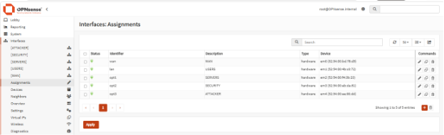
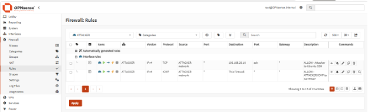
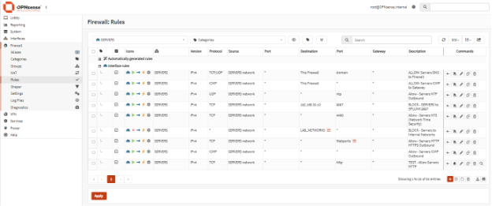
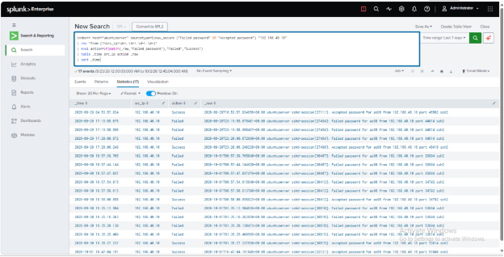
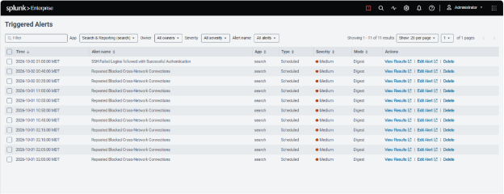
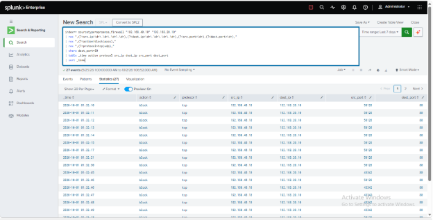
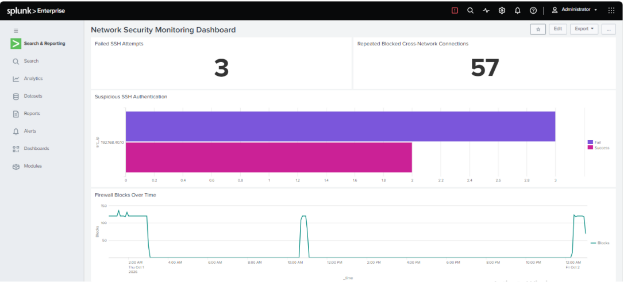
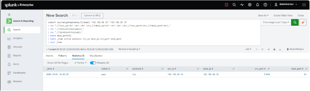

# Network Security Monitoring & Detection Lab

**Version 1 (V1): Network Segmentation, Centralized Logging, Splunk Detection & Alerting**

A hands-on cybersecurity lab built to showcase network segmentation using isolated virtual networks, firewall policy enforcement, centralized logging, SIEM detection, alerting, and incident investigation.
The environment uses OPNsense for routing and firewalling, Splunk for centralized log analysis, Kali Linux as a controlled attacker system, Ubuntu as a monitored server, and Windows 11 as a user workstation.

## Project Objectives

The goal of this project was to build a segmented virtual network and simulate SOC monitoring workflow.
The lab was designed to:
- Separate systems into different network segments (USERS,SERVERS,SECURITY and ATTACKER)
- Control communication between those networks using firewall rules (OPNsense)
- Collect Linux authentication and firewall logs in Splunk.
- Generate controlled attack traffic from Kali Linux.
- Create SPL detections and scheduled alerts.
- Build a Network Security Monitoring dashboard in Splunk.
- Investigate different log sources for suspicious activity.

## Architecture

The lab is divided into four separate virtual network segments with each segment connected to a dedicated OPNsense interface.

| Network | Subnet | Purpose |
|---|---|---|
| USERS | `192.168.10.0/24` | Windows 11 user workstation |
| SERVERS | `192.168.20.0/24` | Ubuntu server being monitored |
| SECURITY | `192.168.30.0/24` | Splunk server and monitoring tools |
| ATTACKER | `192.168.40.0/24` | Kali Linux used to generate controlled attack traffic |

OPNsense acts as the router and firewall between all four networks.
Each network is connected to a separate virtual interface on OPNsense:
-  USERS        →   `192.168.10.1`
-  SERVERS      →   `192.168.20.1`
-  SECURITY     →   `192.168.30.1`
-  ATTACKER     →   `192.168.40.1`

Traffic between the network segments is routed through OPNsense, where firewall rules determine whether the traffic is allowed or blocked.

### OPNsense Interface Layout



## Firewall & Network Segmentation

OPNsense controls traffic between the internal network segments using interface-based firewall rules.
Only the traffic that was needed for the lab was allowed while blocking unnecessary communication between networks.

### ATTACKER Network

The ATTACKER network contains the Kali Linux system that was used to generate controlled attack traffic.
A firewall rule was added in OPNsense allowing Kali to reach the Ubuntu server over SSH:
- Source:           `ATTACKER net`
- Destination:      `192.168.20.10`
- Protocol:         `TCP`
- Destination port: `22`

This allows SSH testing while other cross-network traffic remains restricted.



### SERVERS Network

The SERVERS network contains the Ubuntu server used as the monitored target system.
Firewall rules added:
- Allow DNS to OPNsense on port `53`
- Allow NTP on UDP `123`
- Allow NTS on TCP `4460`
- Allow the Ubuntu server to forward logs to Splunk on TCP `9997`
- Block other traffic from SERVERS to internal lab networks
- Allow web traffic on ports `80` and `443`



## Log Collection & Splunk

Splunk was used as the central SIEM platform for collecting and analyzing logs from the lab.
Log sources:
- Ubuntu authentication logs
- OPNsense firewall logs

### Ubuntu Authentication Logs

The monitored Ubuntu server sends authentication logs to Splunk using the Splunk Universal Forwarder.
The forwarder monitors `/var/log/auth.log` and forwards the logs to the Splunk server at `192.168.30.10` on TCP port `9997`.
The logs use the sourcetype `linux_secure`.

### OPNsense Firewall Logs

OPNsense was configured to send firewall logs to Splunk using remote syslog on UDP port `5514` because port `514` is a privileged port on Linux.
OPNsense sends the logs from `192.168.30.1` to the Splunk server at `192.168.30.10`.
The logs are stored with the sourcetype `opnsense_firewall` and are used to review allowed and blocked traffic between the lab networks.


## Detection 1 - Suspicious SSH Authentication

To test SSH monitoring, I generated multiple failed login attempts from the Kali Linux system at `192.168.40.10` against the Ubuntu server at `192.168.20.10`, followed by a successful login.
The goal was to detect a pattern where repeated failed authentication attempts are followed by a successful login from the same source IP.

### Detection SPL

```spl
index=* host="ubuntuserver" sourcetype=linux_secure ("Failed password" OR "Accepted password")
| rex "from (?<src_ip>\d+\.\d+\.\d+\.\d+)"
| eval action=if(match(_raw,"Failed password"),"Fail","Success")
| stats count(eval(action="Fail")) as Failed
        count(eval(action="Success")) as Success
        earliest(_time) as first_seen
        latest(_time) as last_seen
        by src_ip
| where Failed >= 3 AND Success >= 1
| convert ctime(first_seen) ctime(last_seen)
```

The SPL query extracts the source IP from SSH authentication logs, counts failed and successful login attempts, and identifies sources with at least three failed attempts and one successful login.

### Investigation SPL

```spl
index=* host="ubuntuserver" sourcetype=linux_secure ("Failed password" OR "Accepted password") "192.168.40.10"
| rex "from (?<src_ip>\d+\.\d+\.\d+\.\d+)"
| eval action=if(match(_raw,"Failed password"),"Failed","Success")
| table _time src_ip action _raw
| sort _time
```
This query shows the timestamp, source IP, authentication result, and original log entry for each SSH event, making it easier to review the sequence of failed and successful login attempts.



### Scheduled Alert

The SSH detection was saved as a scheduled Splunk alert so the search could run automatically.
The alert was configured to:
- Run every 5 minutes.
- Check recent authentication events.
- Trigger when the search returns at least one result.
- Use Medium severity.
- Add the event to Splunk's Triggered Alerts.

Schedule:
```text
*/5 * * * *
```


## Detection 2 - Repeated Blocked Cross-Network Connections

To test firewall monitoring, I generated repeated HTTP connection attempts from the Kali Linux system at `192.168.40.10` to the Ubuntu server at `192.168.20.10`.
Because only SSH traffic was allowed between the ATTACKER and SERVERS networks, the HTTP traffic on TCP port `80` was blocked by OPNsense.
The goal was to detect repeated blocked connection attempts between internal lab networks.

### Detection SPL

```spl
index=* sourcetype="opnsense_firewall" "block"
| rex ",(?<src_ip>\d+\.\d+\.\d+\.\d+),(?<dest_ip>\d+\.\d+\.\d+\.\d+),(?<src_port>\d+),(?<dest_port>\d+),"
| rex ",(?<protocol>tcp|udp),"
| stats count as Blocked_Attempts by src_ip dest_ip dest_port protocol
| where Blocked_Attempts >= 5 AND dest_ip!="192.168.40.1"
```

This query extracts the source IP, destination IP, ports, and protocol from the OPNsense firewall logs and counts repeated blocked connection attempts.
The destination `192.168.40.1` is excluded to remove noisy blocked traffic between the Kali system and its own OPNsense gateway.

### Investigation SPL

After the detection identified repeated blocked connections, I used a separate query to review the individual firewall events.

```spl
index=* sourcetype=opnsense_firewall "192.168.40.10" "192.168.20.10"
| rex ",(?<src_ip>\d+\.\d+\.\d+\.\d+),(?<dest_ip>\d+\.\d+\.\d+\.\d+),(?<src_port>\d+),(?<dest_port>\d+),"
| rex ",(?<action>block|pass),"
| rex ",(?<protocol>tcp|udp),"
| where dest_port=80
| table _time action protocol src_ip dest_ip src_port dest_port
| sort _time
```

This query shows the individual firewall events for HTTP traffic from the Kali system to the Ubuntu server and confirms that the connections were blocked by OPNsense.



### Scheduled Alert

The detection was also saved as a scheduled Splunk alert.
The alert was configured to:
- Run every 5 minutes.
- Check recent firewall events using a lookback window.
- Trigger when the search returns at least one result.
- Use Medium severity.
- Add the event to Splunk's Triggered Alerts.

Schedule:
```text
*/5 * * * *
```

## SOC Dashboard

A Splunk dashboard was created to provide a quick view of suspicious activity across the lab.
The dashboard includes:
- Failed SSH Attempts.
- Suspicious SSH Authentication.
- Repeated Blocked Cross-Network Connections.
- Firewall Blocks Over Time.



## Incident Investigation

After the SSH detection identified suspicious authentication activity, I reviewed both the Ubuntu authentication logs and the OPNsense firewall logs to understand what happened.

### Authentication Evidence

The Ubuntu authentication logs showed multiple failed SSH login attempts from the Kali Linux system at `192.168.40.10`, followed by successful authentication to the Ubuntu server at `192.168.20.10`.
The investigation query showed the sequence of failed and successful login events along with the original log entries.

### Firewall Correlation

I then reviewed the OPNsense firewall logs to confirm whether the SSH connection was allowed through the network.
The firewall logs showed TCP traffic from:
- Source: `192.168.40.10`
- Destination: `192.168.20.10`
- Destination port: `22`
- Action: `pass`
This confirmed that the SSH connection was permitted by the configured ATTACKER firewall rule.



### Conclusion

The activity was intentionally generated from the Kali Linux system as part of this lab.
The investigation showed:
- Repeated failed SSH authentication attempts.
- A successful SSH login from the same source IP.
- OPNsense allowing the connection on TCP port `22`.
- Correlation between host authentication logs and firewall logs.

This demonstrated how multiple log sources can be used together to investigate suspicious authentication activity.

## Troubleshooting & Lessons Learned

Building the lab involved several networking and system issues that required troubleshooting across multiple layers.

### OPNsense Interface Assignment

The OPNsense interfaces were initially mapped incorrectly, which caused DHCP and connectivity problems.
I corrected the interface assignments so each virtual network was connected to the proper OPNsense interface.

### Host Firewall Blocking Forwarded Traffic

The Ubuntu server could reach OPNsense, but internet traffic was not leaving the CachyOS host.
Packet captures showed that forwarded traffic reached the host but was being blocked by the host firewall.
The issue was resolved by allowing forwarded traffic from the libvirt NAT network through the host firewall.

### Time Synchronization

Ubuntu showed that NTP was active, but the system clock was not synchronized.
Chrony was using Network Time Security (NTS), which required TCP port `4460` in addition to UDP port `123`.
After allowing TCP `4460` through OPNsense, the systems synchronized successfully.

### Lessons Learned

This project helped me demonstrate:
- Network segmentation and routing.
- Firewall rule design.
- Log forwarding and syslog.
- Splunk data ingestion.
- SPL field extraction.
- Detection logic and alerting.
- Correlating firewall and host logs.
- Troubleshooting across network, operating system, and application layers.

## Future Improvements

Version 2 of this lab will focus on adding deeper network visibility and additional detections.
Planned improvements include:
- Add Zeek for network traffic metadata and protocol visibility.
- Add Suricata for IDS alerting.
- Ingest Zeek and Suricata logs into Splunk.
- Create detections for port scanning and suspicious DNS activity.
- Add additional dashboard panels for network-based detections.
